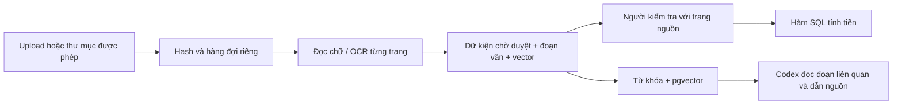

# Kho hồ sơ: nhập một lần, tính bằng SQL, hỏi điều khoản có nguồn

Bản đầu tích hợp vào ứng dụng hiện tại. Gemini API là OCR mặc định đã kiểm tra và tiếp tục phục vụ trích xuất JSON/embedding. PaddleOCR-VL là lựa chọn server có cấu hình riêng, cần nghiệm thu trước khi chuyển. Supabase lưu dữ liệu và chạy truy vấn; Codex đăng nhập hiện có dùng cho câu hỏi cần diễn giải. Máy dev không quyết định cấu hình server bàn giao.

Số tệp và số hợp đồng được đếm riêng: nhiều chứng từ có thể thuộc cùng một hợp đồng. Ảnh chỉ gửi Google khi chọn OCR API hoặc bật và phát sinh dự phòng; chữ dùng trích xuất/embedding vẫn gửi Google, các đoạn dùng diễn giải gửi Codex. Xem [cấu hình OCR và nghiệm thu](DOCUMENT_KNOWLEDGE_OCR.md).

## Vì sao chọn hướng này cho bản đầu

- Tổng tiền do SQL tính trên dữ kiện đã xác minh, giữ quy tắc lũy kế và chống trùng nghiệp vụ. Chi phí đọc lại 83 tệp không đi theo mỗi câu hỏi; các truy vấn rõ nghĩa và nút Xem tổng không gọi model.
- Tìm điều khoản dùng từ khóa cùng vector để lấy đúng phần liên quan, có nguồn trang. Đây là cách [hybrid search trên Supabase](https://supabase.com/docs/guides/ai/hybrid-search), tách khỏi phép tính tổng.
- OCR mặc định dùng API đã thử; Paddle trên server là tùy chọn chưa nghiệm thu. `gemini-embedding-001` tiếp tục phục vụ văn bản theo [tài liệu Google](https://ai.google.dev/gemini-api/docs/embeddings); đã thử API thật với vector 768 chiều.
- Bản đầu dùng các hàm nghiệp vụ có schema, chưa cần thêm WrenAI để phục vụ vài chỉ tiêu đã định nghĩa. Khi có thêm nguồn dữ liệu và báo cáo linh hoạt, đánh giá WrenAI trên các chỉ tiêu và bộ ca kiểm chứng đang có.

Đây là lựa chọn phù hợp cho phạm vi hiện tại, chưa phải kết luận model nào tốt nhất trên mọi bộ hồ sơ. Trước khi công bố hiệu quả vận hành, cần đo độ đúng OCR/dữ kiện, tìm điều khoản và usage trên mẫu đại diện rồi đủ 83 tệp thật. Các số đo Codex bên dưới cho thấy vẫn có overhead, không cam kết 400 token/câu.



## Chuẩn bị

- Node >= 22.18; đã kiểm tra với Node 24.14, Python 3.12, PyMuPDF 1.28.0.
- Supabase hiện có, gồm URL, anon/publishable key theo cấu hình ứng dụng và **service role chỉ ở server/worker**.
- Gemini API key có quyền gọi model đã chọn. Đã kiểm tra thật embedding 768 chiều, trích xuất JSON và OCR ảnh synthetic với tài khoản được cung cấp; chưa đánh giá trên hồ sơ thật của nhóm.
- Codex CLI trên máy chạy server, đăng nhập bằng tài khoản vận hành. Đã thử CLI `0.169.0-alpha.11.1`, model `gpt-6-luna`.
- Tệp gốc giữ ngoài Git và ngoài thư mục public của ứng dụng. Không cấu hình thư mục cache thành thư mục Tri thức dùng chung.

Trong thư mục `quan-ly-nhan-su`:

```powershell
pnpm.cmd install --frozen-lockfile
python -m pip install -r scripts/requirements-knowledge.txt
```

## 1. Cài schema trên Supabase

Chạy `../supabase/migration_20261116_document_knowledge.sql` bằng SQL Editor hoặc tài khoản chủ database. Migration tạo các bảng `dk_*`, RLS, các hàm nghiệp vụ và bucket **private** `document-knowledge`; không sửa các bảng nghiệp vụ hàn hiện có. Có thể chạy lại.

Kiểm tra trước nếu database đã cài pgvector/unaccent:

```sql
select e.extname, n.nspname
from pg_extension e join pg_namespace n on n.oid = e.extnamespace
where e.extname in ('vector', 'unaccent');
```

Migration dùng schema `extensions`. Nếu extension hiện ở schema khác, quản trị database cần điều chỉnh tương thích trước; không tự chuyển schema extension đang được ứng dụng khác sử dụng. Nếu lỗi, giao dịch migration rollback.

## 2. Cấu hình server

Điền `.env.local` dựa trên `.env.example`, giữ các biến Supabase hiện tại và bổ sung:

```dotenv
DOCUMENT_KNOWLEDGE_ENABLED=true
GEMINI_API_KEY=<key riêng trên server>
KNOWLEDGE_EXTRACT_MODEL=gemini-3.5-flash-lite
KNOWLEDGE_EMBEDDING_MODEL=gemini-embedding-001
KNOWLEDGE_OCR=gemini
KNOWLEDGE_PADDLE_PROFILE=vl
KNOWLEDGE_OCR_FALLBACK=gemini
KNOWLEDGE_MAX_PAGES=250
KNOWLEDGE_PYTHON=python
KNOWLEDGE_CODEX_MODEL=gpt-6-luna
CHAT_CONTRACT_DIR=E:\duong-dan-kho-ho-so
KNOWLEDGE_LOCAL_SCAN_USERS=<UUID hoặc email quản trị được phép nhập thư mục>
CHAT_LEGACY_ADMIN_IDS=
```

Gemini mode không cài model local. Nếu muốn chuyển sang Paddle, cài dependencies riêng và chạy preflight/smoke trên server trước; adapter PaddleOCR-VL 1.6 có cấu hình CPU/GPU nhưng chưa được nghiệm thu model thật trong đợt này. Model classic nhỏ không đạt giữ dấu tiếng Việt trên mẫu đã thử. Chi tiết: [DOCUMENT_KNOWLEDGE_OCR.md](DOCUMENT_KNOWLEDGE_OCR.md).

Trên Windows, nếu server không tìm được `codex.exe`, đặt `KNOWLEDGE_CODEX_BINARY` thành đường dẫn tuyệt đối tới executable. Không dùng `codex.cmd` cho biến này. Có thể tra executable bằng `(Get-Command codex.exe).Source`. `KNOWLEDGE_CODEX_HOME` trỏ tới thư mục đăng nhập Codex của tài khoản chạy server nếu cần; không đưa `auth.json` vào repository.

`KNOWLEDGE_CACHE_DIR` tùy chọn, mặc định `.codex-chat/knowledge-cache`. Đây là dữ liệu riêng chứa chữ OCR và vector, cần giữ trên ổ đĩa riêng của server. Không xóa cache khi khởi động lại worker nếu muốn dùng kết quả đã xử lý.

`CHAT_LEGACY_ADMIN_IDS` mặc định trống: CLI cũ có quyền toàn server bị chặn với mọi người dùng. Chỉ thêm tài khoản quản trị thật sự tin cậy nếu còn cần chức năng cũ. Khi bật kho hồ sơ mới, cây AI_QS và các URL cũ trỏ vào thư mục AI_QS cũng được giới hạn tương ứng; người dùng xem bản gốc qua nguồn đã kiểm tra quyền từng kho. File Tri thức ngoài cây AI_QS giữ quy tắc của module hiện có.

## 3. Nhập hồ sơ và chạy worker

Mở **Hồ sơ AI_QS → Kho hồ sơ hỏi đáp**, tạo kho; người tạo là owner. Thêm vài tệp đại diện trước, kiểm tra OCR và cách phân loại, rồi nhập cả kho. Có thể upload nhiều tệp hoặc nhập đường dẫn tương đối dưới `CHAT_CONTRACT_DIR` nếu tài khoản được cho phép. Thư mục rỗng trong ô nhập nghĩa là toàn bộ root được cấu hình.

Chạy worker ở tiến trình riêng:

```powershell
pnpm.cmd knowledge:worker -- --watch
```

Nếu muốn worker định kỳ quét một thư mục local và xử lý hàng đợi:

```powershell
pnpm.cmd knowledge:worker -- --watch --project <UUID-kho> --folder "Tong hop HD voi ben A"
```

Quét một lần:

```powershell
pnpm.cmd knowledge:scan -- --project <UUID-kho> --folder "Tong hop HD voi ben A"
```

Tên thư mục thực tế có thể có dấu và khoảng trắng; luôn đặt trong dấu nháy. Worker quét mỗi 60 giây ở chế độ watch có project; không có project thì chỉ xử lý hàng đợi. Chạy worker dưới trình quản lý tiến trình có khởi động lại khi lỗi khi đưa vào vận hành lâu dài.

- Tệp không đổi hash và phiên bản pipeline không tạo job mới. Khi đổi hash/model/pipeline, các dữ kiện cũ ngừng được tính và phiên bản mới phải được kiểm tra lại.
- Đọc lớp chữ PDF trước; trang scan/ảnh lớn có header vẫn qua engine OCR được chọn. Gemini là mặc định; nếu chọn Paddle thì có dự phòng Gemini theo trang và giới hạn. PDF hỗn hợp giữ đủ trang/số trang; stdout Python đọc có backpressure. Metadata/cảnh báo OCR không thay cho việc duyệt bản gốc.
- OCR lưu từng trang thành checkpoint; embedding lưu từng nhóm 8 đoạn. Thử lại sau lỗi không gọi lại các bước đã hoàn thành và cache còn nguyên. Publish vào DB là một giao dịch: không công bố nửa tài liệu.
- Job có lease, heartbeat, nhận lại khi worker bị dừng; worker cũ không thể ghi đè job phiên bản mới. Nếu mất lease thì ngừng yêu cầu AI đang chạy.
- Tệp quá giới hạn hoặc định dạng không hỗ trợ được đánh dấu lỗi, vẫn hiện trong độ phủ. Hiện hỗ trợ PDF, PNG/JPEG/WebP, TXT/MD/CSV/JSON, XLS/XLSX. DOCX/ZIP chưa có adapter.
- Upload trong panel tối đa 50 MB/tệp; đính kèm qua khung chat giữ giới hạn cũ 25 MB/tệp. Mặc định 250 trang PDF (tối đa 500), 3.000 đoạn; không âm thầm bỏ phần vượt giới hạn.
- Khi quét local hoàn tất mới đánh dấu các đường dẫn biến mất là ngừng sử dụng. Không xóa tệp gốc. Nguồn local cần tiếp tục khả dụng đúng hash; hệ thống chưa lưu lịch sử binary của mọi phiên bản local. Nếu cần phục hồi bản gốc lịch sử, giữ bản sao riêng hoặc dùng upload private bất biến theo hash. Trang trích xuất, dữ kiện cũ và audit vẫn lưu theo revision.
- Với TXT/MD/CSV/JSON, trang là mỗi 12.000 ký tự; Excel là CSV theo sheet chia tương tự. Dẫn nguồn theo trang chỉ khớp trang vật lý đối với PDF/ảnh.

## 4. Xác minh dữ kiện trước khi tính

Mỗi dữ kiện mới đều ở trạng thái **chờ kiểm tra**. Mở bản gốc đúng trang, sửa loại tiền, số hợp đồng, ngày, số đợt, tiền nguyên đồng và mã nghiệp vụ; ghi căn cứ rồi xác minh hoặc loại bỏ. Có thể bổ sung dữ kiện bị bỏ sót bằng đoạn trích thực sự có trên trang.

Một khoản xuất hiện ở nhiều chứng từ phải cùng mã nghiệp vụ. Mã nên chứa loại, hợp đồng và định danh thực tế, ví dụ `PAY:HD05:FT262345678`, `ACCEPT:HD05:4`, `AMEND:HD05:02`. Chọn một chứng từ đại diện để duyệt, loại các bản trùng; database chặn hai khoản cùng mã được duyệt. Không dùng tên tệp làm định danh giao dịch.

Sau khi kiểm tra đủ toàn bộ trang và dữ kiện, xác nhận **Hoàn tất kiểm tra tài liệu**, kể cả tài liệu không có số tiền. Thao tác sửa dữ kiện sau đó làm tài liệu trở về chưa kiểm tra. Có khóa phiên bản khi hai người duyệt đồng thời và audit người duyệt/căn cứ.

## Các chỉ tiêu được định nghĩa

| Chỉ tiêu | Quy tắc |
| --- | --- |
| `contract_total` | Hợp đồng gốc + phần điều chỉnh tăng/giảm của phụ lục. Phụ lục ghi tổng mới phải được đổi thành phần chênh lệch khi đối soát; không cộng tổng mới lần nữa. Thiếu hợp đồng gốc thì báo xung đột. |
| `accepted_total` | Theo từng hợp đồng: số lũy kế ở kỳ cuối cùng + các khoản riêng đợt ở kỳ sau nó. Không cộng các đợt đã nằm trong lũy kế. Kỳ sau nhưng ngày trước bản lũy kế thì chưa xuất tổng. |
| `paid_total` | Chứng từ thực chuyển đã xác minh; không gồm đề nghị thanh toán hoặc tạm ứng được phân loại riêng. |
| `payment_requested_total` | Giá trị đề nghị thanh toán, không chứng minh tiền đã chuyển. |
| `advance_total` | Tạm ứng được phân loại riêng. Không tự cộng vào `paid_total`; người duyệt phải thống nhất cách phân loại chứng từ tạm ứng thực chuyển. |

Tiền hiện chỉ hỗ trợ VND nguyên đồng, lưu decimal trong PostgreSQL, truyền bằng chuỗi và hiển thị bằng BigInt. Không dùng số thực JavaScript để cộng tiền. `NULL` nghĩa là chưa có số liệu xác minh, không tự đổi thành 0. Database không thể tự chứng minh OCR/nghiệp vụ đúng; xác nhận của người kiểm tra vẫn là điều kiện cần.

## Cách hỏi và mức sử dụng model

1. **Xem tổng** trong kho: SQL trực tiếp, không gọi Codex/Gemini.
2. Câu đầu của hội thoại đúng một ý thông dụng như **“Tổng giá trị nghiệm thu?”**, **“Tổng giá trị hợp đồng?”**, **“Tổng tiền thực chuyển?”**: dùng hàm SQL trực tiếp, trả usage 0. Không áp dụng shortcut cho câu có bộ lọc/ngày hoặc câu tiếp nối có thể kế thừa phạm vi trước đó.
3. Câu tổng hợp khác: Codex tạo JSON chọn hàm, metric, mã hợp đồng tùy chọn và ngày chốt. Backend kiểm tra schema/quyền, gọi SQL viết sẵn và tự định dạng kết quả. Không gửi 83 tệp/dòng dữ liệu cho Codex, không chạy SQL tự do do model sinh.
4. Câu điều khoản: một embedding cho câu hỏi ngắn, kết hợp từ khóa tiếng Việt không dấu với pgvector, lấy tối đa 6 đoạn mỗi lần tìm rồi Codex diễn giải phần được giới hạn. Nếu dịch vụ embedding gián đoạn, vẫn tìm bằng từ khóa. Nguồn dẫn chỉ chấp nhận ID/trang thực đã lấy và URL yêu cầu đăng nhập.
5. Câu “tổng tiền” không rõ chỉ tiêu: hỏi lại. Bộ lọc tài chính hiện hỗ trợ toàn kho, đúng số hợp đồng và **đến ngày**; chưa hỗ trợ tùy ý đối tác, hạng mục hoặc khoảng từ ngày/đến ngày. Không thay bằng tổng toàn kho khi không đáp ứng được bộ lọc.

Kết quả tổng luôn kèm số tài liệu đã xử lý/kiểm tra, số dữ kiện chờ duyệt, xung đột và nguồn. Chưa kiểm tra đủ kho không được trình bày thành tổng đầy đủ. Các nguồn trong phản hồi giới hạn 20 để giữ kết quả gọn, có `sources_truncated`; phép tính vẫn chạy toàn bộ dữ liệu hợp lệ, không bị giới hạn 20/1.000 dòng.

Đăng nhập Codex không đồng nghĩa input token bằng 0. Thử kết nối rất ngắn với CLI mặc định dùng 13.472–14.112 input token; cấu hình riêng cho truy vấn bounded còn 8.267 token. Ba phép thử planner thật dùng 8.700–8.711 input token/lượt, một lượt có 6.528 cached input token. Đây là **số đo synthetic ngày 16/11/2026 trên máy này**, không phải benchmark 83 tệp hay cam kết chi phí/quota tài khoản. Truy vấn điều khoản còn có lượt diễn giải thứ hai. Xem `dk_usage` để đo plan/answer thực tế; không ghi prompt/nội dung hồ sơ vào bảng usage.

Gateway Codex dùng tiến trình riêng `--ephemeral --ignore-user-config`, Standard tier, schema JSON, cwd tạm, tắt shell/web/ảnh/agent/plugin và không truyền các key Supabase/Gemini. Hướng dẫn ngắn thay cho hướng dẫn coding chỉ áp dụng cho tiến trình con; không sửa cấu hình Codex của người dùng. [Các khóa cấu hình chính thức](https://developers.openai.com/codex/config-reference).

## Kiểm tra

```powershell
pnpm.cmd test:knowledge
node scripts/test-chat-api.mjs
node scripts/test-chat-upload.mjs
node scripts/test-chatbot.mjs
# Tùy chọn, có gọi Google API và sử dụng hạn mức: chỉ gửi dữ liệu synthetic.
pnpm.cmd knowledge:smoke -- --live
$env:NODE_OPTIONS='--max-old-space-size=4096'
pnpm.cmd build
```

`test:knowledge` không gọi API thật hoặc database production. Nó dùng PostgreSQL/pgvector WASM thực (PGlite), PDF hỗn hợp tạo tại chỗ, Google/Codex giả lập. Bao gồm tính không trùng lũy kế, hơn 1.000 khoản, lọc hợp đồng/ngày, RLS, quyền viewer, thay phiên bản, lease, rollback, chữ/số lớn, dẫn nguồn giả, token routing và khôi phục OCR/embedding sau lỗi.

Đã kiểm tra riêng ba planner bằng Codex đăng nhập thật, bốn lời gọi Gemini thật (embedding tài liệu/câu hỏi, trích xuất JSON, OCR ảnh synthetic) và giao diện bằng Edge headless ở chiều rộng 1.440/390 px với API fixture. Migration trên Supabase thật được để lại cho đồng nghiệp phụ trách theo yêu cầu của anh Huy; chưa chạy trên bộ 83 hồ sơ thật. Tính năng local được giữ `DOCUMENT_KNOWLEDGE_ENABLED=false` cho đến khi schema sẵn sàng. Xem [hướng dẫn bàn giao](DOCUMENT_KNOWLEDGE_HANDOFF.md).

## Điểm mở rộng

- `KNOWLEDGE_METRICS` và `dk_financial_summary` là định nghĩa chỉ tiêu của bản đầu. Khi gắn WrenAI, ánh xạ lại những định nghĩa này và bộ ca kiểm chứng; giữ lớp xác minh dữ kiện và nguồn trang.
- Có thể thêm bộ lọc đối tác/hạng mục, đồng tiền, sự kiện hoàn tiền, đối soát tạm ứng, lưu binary lịch sử, index ANN hoặc worker nhiều máy sau khi có dữ liệu thật và số đo. Không cần thay chatbot/UI hay đưa lại toàn bộ tài liệu vào prompt.
- Zalo/NotebookLM MCP chưa nằm trong thay đổi này. Tích hợp kênh chat sau sẽ gọi cùng các hàm có quyền từng kho.
